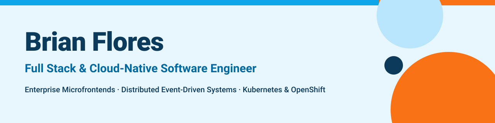

  

---

## About me

Software Engineering graduate (Ingeniería en Desarrollo y Tecnologías de Software, UNACH — graduating December 2026) and Full Stack Developer focused on modern web platforms, microfrontends, distributed systems and cloud-native delivery.

I build real-world applications with React, TypeScript, Node.js, GraphQL, PostgreSQL, Redis, Kafka, Docker and Kubernetes, and I care about observability and production-oriented problem solving. I'm especially interested in backend architecture, DevOps workflows and AI coding evaluation.

- Languages: Spanish (native) · English (B1, technical proficiency)

---

## Tech stack

**Frontend** 

**Backend** 

**Data & messaging** 

**DevOps & cloud** 

**Quality & observability** 

Also: Apollo Federation v2, Module Federation, Helm, ArgoCD, OpenShift, Loki, Jaeger/Tempo, OpenTelemetry, Vitest, Supertest, SonarQube.

---

## Cloud-native, in motion

  

  

---

## Featured projects

### FoodDash — Real-time cloud-native food delivery platform

A distributed food delivery platform inspired by Uber Eats, built to demonstrate production-style backend engineering: event-driven architecture, real-time order tracking, security, testing and observability.

- Microservices architecture with six decoupled services: auth, restaurant, order, delivery, notification and API gateway.
- Federated GraphQL gateway with Apollo Federation v2, Apollo Server, Express and TypeScript.
- Real-time order tracking with GraphQL Subscriptions, WebSockets, Redis Pub/Sub and Apollo Client.
- Asynchronous events over Apache Kafka (`order.created`, `delivery.assigned`, `order.cancelled`, status updates) with consumer groups, retries, exponential backoff and DLQs.
- JWT access/refresh tokens, bcrypt, RBAC, rate limiting and a Redis token blacklist for logout invalidation.
- Deployment assets with Docker, Kubernetes, Helm, HPA, ArgoCD, GitHub Actions and Terraform-oriented AWS infrastructure.
- Observability with Prometheus, Grafana, Loki, Jaeger/Tempo and OpenTelemetry.

**Stack:** React · Vite · TypeScript · Apollo Client · Node.js · Express · Apollo Federation · PostgreSQL · Redis · Kafka · Docker · Kubernetes · Helm · ArgoCD · Terraform · Prometheus · Grafana · Loki · OpenTelemetry · Jest · Vitest

### Enterprise payments microfrontend

A microfrontend for a service consultation and payment workflow, integrated with a host platform.

- React 19, TypeScript, Vite, Tailwind CSS and Vite Module Federation, exposing the remote module through `remoteEntry.js`.
- Multi-step transactional flow: consultation, access validation, confirmation, payment execution and receipt printing.
- External services consumed with Fetch API and XML payloads, with loading states, timeouts and structured error handling.
- Build-time and runtime configuration separated through environment variables and dynamic JSON, so environments change without rebuilding.
- Containerized with Docker multi-stage builds and Nginx, with OpenShift/Kubernetes-oriented resources.

**Stack:** React 19 · TypeScript · Vite 7 · Module Federation · Tailwind CSS 4 · i18next · React Hook Form · Zod · Docker · Nginx · OpenShift · ESLint · Stylelint · SonarQube

### University projector loan management system (in production)

A complete system for managing projector loans at a university faculty, used by authorized staff for resource control and loan tracking.

- Loan registration, real-time inventory control, loan history, authentication, role-based access and an administrative dashboard.
- Reduces manual tracking and improves visibility of equipment availability.

**Stack:** React · Node.js · MongoDB Atlas

---

### Let's connect

Open to talking about backend architecture, microfrontends and cloud-native systems.

